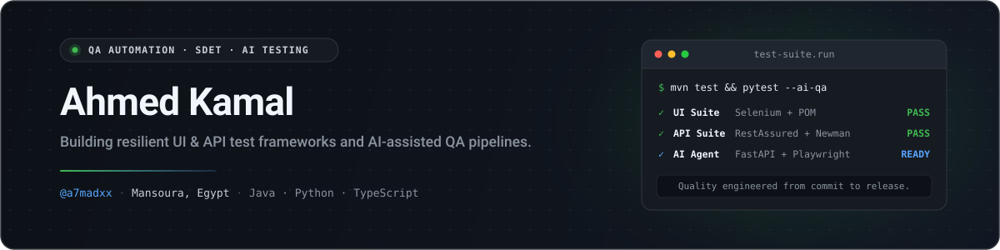

  <picture>
    <source media="(prefers-color-scheme: dark)" srcset="./assets/banner-dark.svg" />
    <source media="(prefers-color-scheme: light)" srcset="./assets/banner-light.svg" />
    
  </picture>

   
   

  

    QA Automation Engineer &amp; SDET specializing in maintainable <strong>UI &amp; API test frameworks</strong>
    with Java, Selenium, TestNG, RestAssured, and Postman/Newman. 
    Currently exploring <strong>AI-assisted QA workflows</strong> using Python, FastAPI, React, and Playwright MCP.
  

  <!-- TODO: Replace REPLACE_WITH_YOUR_LINKEDIN and REPLACE_WITH_YOUR_EMAIL with your real contact details before publishing -->
  

    
    
    
  

---

### Featured Work

| Project | Focus | Stack |
| :--- | :--- | :--- |
| **[QA-AI-Automation-Assistant](https://github.com/a7madxx/QA-AI-Automation-Assistant)** | AI-assisted QA automation platform with a stage dashboard and automated test generation pipeline | `Python` `FastAPI` `React` `Playwright MCP` |
| **[Automation-with-Selenium-Swaglabs](https://github.com/a7madxx/Automation-with-Selenium-Swaglabs)** | End-to-end UI automation framework using Page Object Model and JSON data-driven testing | `Java` `Selenium` `TestNG` `POM` |
| **[Reqres-API-using-Restassured](https://github.com/a7madxx/Reqres-API-using-Restassured)** | Automated REST API validation suite covering status, schema, and payload assertions | `Java` `Maven` `RestAssured` `TestNG` |
| **[ReqRes-API-Testing](https://github.com/a7madxx/ReqRes-API-Testing)** | Automated Postman collections with Newman CLI execution and HTML reporting | `Postman` `Newman` `JavaScript` |
| **[AI-Tools-in-Swaglabs-Automation-Testing](https://github.com/a7madxx/AI-Tools-in-Swaglabs-Automation-Testing)** | Exploring AI-assisted authoring and refactoring workflows on top of a Selenium + TestNG POM suite | `Java` `Selenium` `TestNG` `AI Workflows` |

---

### Tech Stack & Tooling

| Area | Tools & Technologies |
| :--- | :--- |
| **UI & E2E Automation** |   -161B22?style=flat-square&logo=playwright&logoColor=2EAD33)  |
| **API & Contract Testing** |    -161B22?style=flat-square&logo=json&logoColor=C9D1D9) |
| **Languages & Frameworks** |         |
| **Build & Workflow** |      |

---

### Engineering & Quality Principles

- **Maintainable Architecture First:** Clean Page Object Model layers, isolated test data (JSON), and deterministic locators to minimize flakiness.
- **Balanced Test Pyramid:** Fast API contract and regression suites (RestAssured, Postman/Newman) backing targeted end-to-end UI flows.
- **Practical AI for QA:** Pairing FastAPI orchestration with Playwright MCP to accelerate test authoring, triage, and feedback loops without sacrificing reliability.

---

  Based in Mansoura, Egypt · Open to QA Automation Engineer &amp; SDET opportunities.

